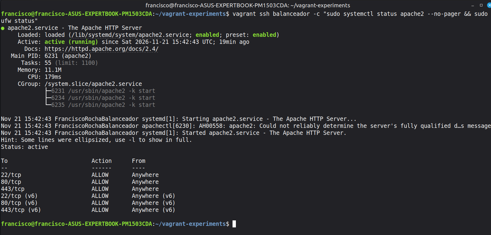
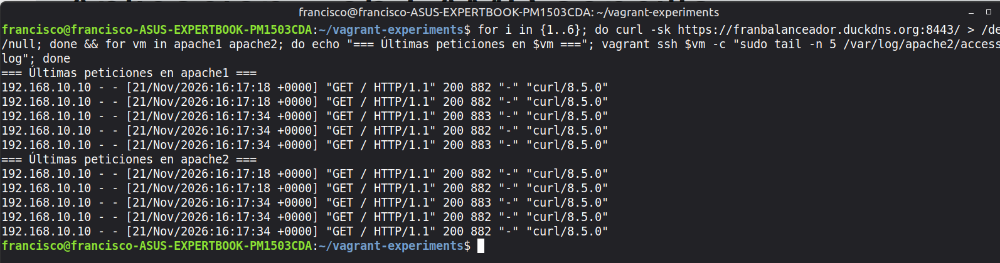
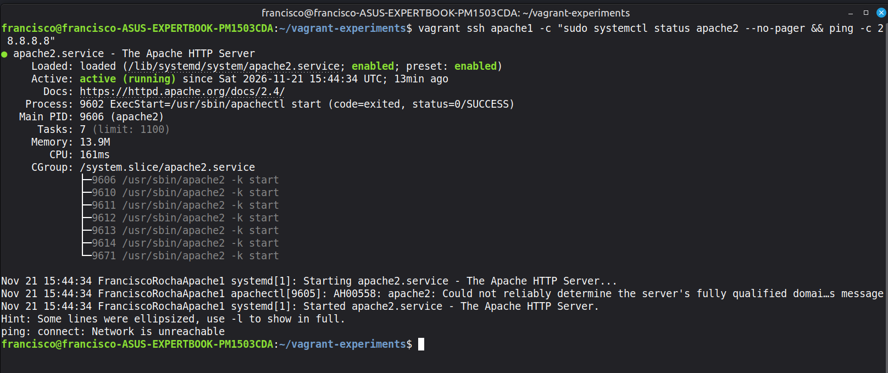
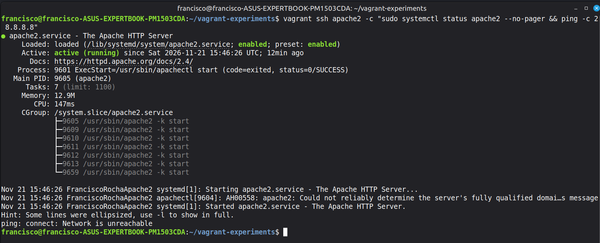
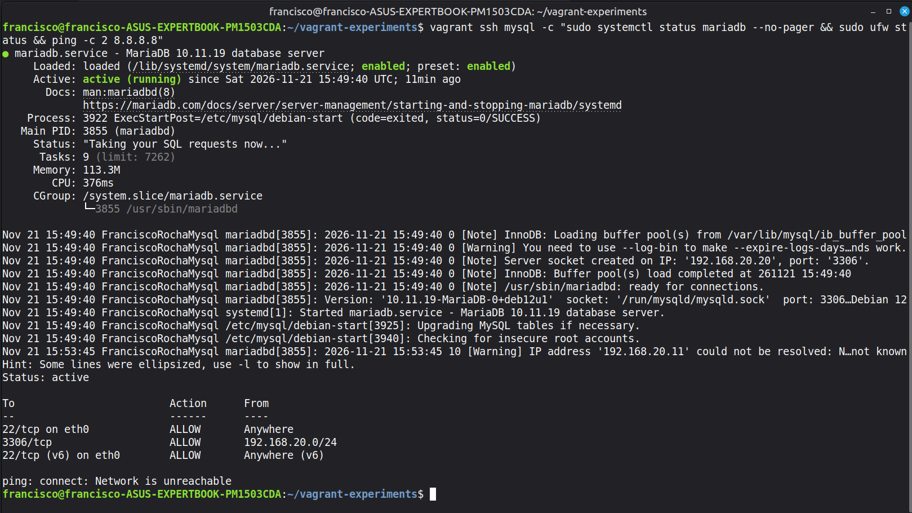

# -Balanceador-de-Carga-con-Apache
# Despliegue de Pila LAMP en Tres Niveles con Balanceo de Carga y SSL

Este documento detalla la infraestructura basada en **Debian 12 (Bookworm)** y **Vagrant** para desplegar una aplicación web en tres capas segmentadas por redes internas aisladas (`red_capa1_capa2` y `red_capa2_capa3`):

- **Capa 1 — Balanceador (`balanceador` - `192.168.10.10`):** Proxy inverso Apache con HTTPS forzado y certificado Let's Encrypt mediante DuckDNS.
- **Capa 2 — Servidores Web (`apache1` y `apache2` - `192.168.10.x` / `192.168.20.x`):** Nodos Apache + PHP sin salida directa a Internet.
- **Capa 3 — Base de Datos (`mysql` - `192.168.20.20`):** Servidor MariaDB protegido en red privada con UFW.

*(Puedes consultar el contenido completo de los archivos de configuración (`Vagrantfile`, `pbalanceador.sh`, `papache.sh` y `pmysql.sh`) en los repositorios de referencia).*

---


## Verificación del Sistema (Capturas de Pantalla)

### 1. Servidor de Balanceo de Carga y SSL (`balanceador`)



### 2. Servidores Web (`apache1` y `apache2`)


### 3. Servidor de Base de Datos (`mysql`)


### Screencast con la aplicación desplegada
A continuación se muestra la grabación de pantalla que demuestra el correcto funcionamiento de la aplicación web interactuando con la base de datos:

##  Scripts de Aprovisionamiento Explicados

A continuación se desglosan los comandos utilizados en la automatización junto con la explicación detallada de cada orden.

###  1. Script del Servidor Web (`papache.sh`)
```bash
#!/bin/bash
# Fuerza al script a detenerse inmediatamente si ocurre algún error durante la ejecución.
set -e

# Configura las instalaciones de apt para que sean automáticas y no soliciten confirmaciones al usuario.
export DEBIAN_FRONTEND=noninteractive

# Actualiza el índice de paquetes locales con las últimas versiones de los repositorios.
apt-get update -y

# Instala el servidor web Apache, PHP, el módulo conector, el driver de MySQL para PHP y la herramienta Git.
apt-get install -y apache2 php libapache2-mod-php php-mysql git

# Limpia por completo el directorio raíz del servidor web eliminando el archivo index.html por defecto.
rm -rf /var/www/html/*

# Se desplaza al directorio temporal del sistema para trabajar de forma aislada.
cd /tmp

# Elimina cualquier rastro previo del repositorio de la práctica si existiera.
rm -rf iaw-practica-lamp

# Clona el repositorio con el código fuente de la aplicación web desde GitHub de forma local.
git clone https://github.com/josejuansanchez/iaw-practica-lamp.git

# Copia de forma recursiva todos los archivos de código PHP de la aplicación al directorio de Apache.
cp -r /tmp/iaw-practica-lamp/src/* /var/www/html/

# Reemplaza la constante DB_HOST en el archivo de configuración para apuntar a la nueva IP del servidor de datos (192.168.20.20).
sed -i "s/define('DB_HOST', '.*');/define('DB_HOST', '192.168.20.20');/" /var/www/html/config.php

# Reemplaza el nombre de la base de datos objetivo con 'lamp_db'.
sed -i "s/define('DB_NAME', '.*');/define('DB_NAME', 'lamp_db');/" /var/www/html/config.php

# Reemplaza el usuario que se conectará con el nombre de usuario configurado 'lamp_user'.
sed -i "s/define('DB_USER', '.*');/define('DB_USER', 'lamp_user');/" /var/www/html/config.php

# Reemplaza la contraseña de conexión por la credencial compartida 'password_seguro'.
sed -i "s/define('DB_PASSWORD', '.*');/define('DB_PASSWORD', 'password_seguro');/" /var/www/html/config.php

# Cambia el propietario de los archivos web al usuario 'www-data' (el de Apache) para otorgar permisos de lectura/escritura correctos.
chown -R www-data:www-data /var/www/html/

# Reinicia el servicio de Apache para aplicar la configuración de PHP y cargar la aplicación limpiamente.
systemctl restart apache2

# Elimina la ruta por defecto (puerta de enlace) para cortar el acceso a Internet en la sesión actual sin desconectar el SSH de Vagrant.
ip route del default || true

# Crea un script en el directorio 'if-up.d' para que la ruta por defecto se elimine automáticamente cada vez que se levante la red tras un reinicio.
cat << 'EOF' > /etc/network/if-up.d/sin-internet
#!/bin/sh
ip route del default 2>/dev/null || true
EOF

# Otorga permisos de ejecución al script para asegurar que el sistema lo aplique en cada arranque.
chmod +x /etc/network/if-up.d/sin-internet

```

###  2. Script del Servidor de Base de datos (`pmysql.sh`)
```bash
#!/bin/bash
# Detiene el script inmediatamente si algún comando devuelve un código de error.
set -e

# Evita pantallas interactivas durante la instalación de paquetes.
export DEBIAN_FRONTEND=noninteractive

# --- 1. Instalación de paquetes ---
# Actualiza el listado de paquetes del sistema operativo mientras hay conexión a Internet.
apt-get update -y

# Instala el motor de base de datos MariaDB, la herramienta Git y el cortafuegos UFW.
apt-get install -y mariadb-server git ufw

# --- 2. Configuración de MariaDB ---
# Modifica la configuración de red de MariaDB para que escuche peticiones en la interfaz privada (192.168.20.20) en lugar de local (127.0.0.1).
sed -i 's/^bind-address.*/bind-address = 192.168.20.20/' /etc/mysql/mariadb.conf.d/50-server.cnf

# Reinicia el servicio de MariaDB para que empiece a escuchar en la nueva dirección IP de la red privada.
systemctl restart mariadb

# Comando SQL para crear la base de datos de la práctica si no existe previamente.
mysql -e "CREATE DATABASE IF NOT EXISTS lamp_db;"

# Crea el usuario 'lamp_user' con contraseña, permitiendo su conexión desde cualquier equipo de la subred privada (192.168.20.%).
mysql -e "CREATE USER IF NOT EXISTS 'lamp_user'@'192.168.20.%' IDENTIFIED BY 'password_seguro';"

# Otorga privilegios completos de lectura, inserción y modificación al usuario sobre la base de datos 'lamp_db'.
mysql -e "GRANT ALL PRIVILEGES ON lamp_db.* TO 'lamp_user'@'192.168.20.%';"

# Limpia los privilegios en memoria para asegurar que las nuevas reglas de acceso surtan efecto inmediato.
mysql -e "FLUSH PRIVILEGES;"

# --- 3. Importación del esquema de la base de datos ---
# Accede a la carpeta temporal del sistema.
cd /tmp

# Elimina restos antiguos del repositorio para evitar conflictos de carpetas.
rm -rf iaw-practica-lamp

# Clona el repositorio oficial de la práctica para obtener el script de estructura de la base de datos.
git clone https://github.com/josejuansanchez/iaw-practica-lamp.git

# Importa las tablas y datos iniciales en la base de datos 'lamp_db'.
mysql lamp_db < /tmp/iaw-practica-lamp/db/database.sql

# --- 4. Configuración del cortafuegos (UFW) ---
# Establece la política por defecto para bloquear todo el tráfico entrante no autorizado.
ufw default deny incoming

# Establece la política por defecto para permitir todo el tráfico saliente desde el servidor.
ufw default allow outgoing

# Permite las conexiones entrantes por SSH (puerto 22 TCP) en la interfaz 'eth0' para no perder la gestión remota de Vagrant.
ufw allow in on eth0 to any port 22 proto tcp

# Permite el tráfico entrante hacia el puerto de MariaDB (3306 TCP) únicamente desde la subred privada del servidor web (192.168.20.0/24).
ufw allow from 192.168.20.0/24 to any port 3306 proto tcp

# Activa el cortafuegos aplicando las reglas configuradas sin pedir confirmación interactiva.
ufw --force enable

# --- 5. Aislamiento de red (sin salida a Internet) ---
# Elimina la ruta por defecto (puerta de enlace) para cortar el acceso a Internet en la sesión actual sin desconectar el SSH de Vagrant.
ip route del default || true

# Crea un script en el directorio 'if-up.d' para que la ruta por defecto se elimine automáticamente cada vez que se levante la red tras un reinicio.
cat << 'EOF' > /etc/network/if-up.d/sin-internet
#!/bin/sh
ip route del default 2>/dev/null || true
EOF

# Otorga permisos de ejecución al script para asegurar que el sistema lo aplique en cada arranque.
chmod +x /etc/network/if-up.d/sin-internet


```

###  3. Script del Balanceador (`pbalanceador.sh`)
```bash
#!/bin/bash
# Detiene el script inmediatamente si algún comando devuelve un código de error.
set -e

# Define las variables con el dominio dinámico de DuckDNS, su token de autenticación y el correo para Let's Encrypt.
DOMINIO="franbalanceador.duckdns.org"
TOKEN_DUCKDNS="4654756743265734"
EMAIL="jkanime00000@gmail.com"

# --- 1. Instalación de Apache, Certbot y el plugin DNS ---
# Configura las instalaciones de apt para que sean automáticas y no soliciten confirmaciones.
export DEBIAN_FRONTEND=noninteractive

# Actualiza el índice de paquetes locales con las últimas versiones de los repositorios.
apt-get update -y

# Instala el servidor web Apache, el cliente Certbot para certificados SSL y el gestor de paquetes de Python (pip).
apt-get install -y apache2 certbot python3-pip

# Instala el complemento de Certbot para validar dominios de DuckDNS mediante registros TXT sin restricción de entorno.
pip3 install certbot-dns-duckdns --break-system-packages

# --- 2. Habilitación de módulos de Apache ---
# Activa los módulos necesarios para proxy inverso, balanceo por peticiones, cifrado SSL y manipulación de cabeceras HTTP.
a2enmod proxy proxy_http proxy_balancer lbmethod_byrequests ssl headers

# --- 3. Generación del certificado SSL válido ---
# Solicita un certificado gratuito a Let's Encrypt de forma desatendida mediante el reto DNS-01 usando la API de DuckDNS.
certbot certonly \
  --non-interactive \
  --agree-tos \
  --email "$EMAIL" \
  --preferred-challenges dns \
  --authenticator dns-duckdns \
  --dns-duckdns-token "$TOKEN_DUCKDNS" \
  --dns-duckdns-propagation-seconds 60 \
  -d "$DOMINIO"

# --- 4. Configuración del VirtualHost y Balanceo de Carga ---
# Sobrescribe la configuración por defecto de Apache para gestionar el tráfico HTTP (80) y HTTPS (443).
cat <<EOF > /etc/apache2/sites-available/000-default.conf
# Redirige de forma permanente todo el tráfico entrante no cifrado (puerto 80) hacia HTTPS.
<VirtualHost *:80>
    ServerName $DOMINIO
    Redirect permanent / https://$DOMINIO/
</VirtualHost>

# Define el servidor virtual seguro (puerto 443) que actúa como punto de entrada HTTPS y proxy inverso.
<VirtualHost *:443>
    ServerName $DOMINIO
    ServerAdmin webmaster@localhost

    # Activa el motor SSL y especifica las rutas al certificado público y la clave privada generados por Certbot.
    SSLEngine on
    SSLCertificateFile /etc/letsencrypt/live/$DOMINIO/fullchain.pem
    SSLCertificateKeyFile /etc/letsencrypt/live/$DOMINIO/privkey.pem

    # Añade una cabecera HTTP para informar a los servidores web internos de que la petición original llegó por HTTPS.
    RequestHeader set X-Forwarded-Proto "https"

    # Define el grupo de servidores backend (clúster) repartiendo las peticiones equitativamente (byrequests).
    <Proxy "balancer://micluster">
        BalancerMember http://192.168.10.11
        BalancerMember http://192.168.10.12
        ProxySet lbmethod=byrequests
    </Proxy>

    # Conserva la cabecera 'Host' original del cliente y reenvía todo el tráfico hacia el clúster balanceado.
    ProxyPreserveHost On
    ProxyPass / balancer://micluster/
    ProxyPassReverse / balancer://micluster/

    # Define los archivos de registro de errores y accesos propios de Apache.
    ErrorLog \${APACHE_LOG_DIR}/error.log
    CustomLog \${APACHE_LOG_DIR}/access.log combined
</VirtualHost>
EOF

# --- 5. Verificación, reinicio y cortafuegos (UFW) ---
# Comprueba que la sintaxis de los archivos de configuración de Apache sea correcta antes de reiniciar.
apache2ctl configtest

# Reinicia el servicio de Apache para aplicar la configuración SSL y activar el balanceador.
systemctl restart apache2

# Instala el cortafuegos UFW.
apt-get install -y ufw

# Establece las políticas por defecto: bloquear todo el tráfico entrante y permitir el saliente.
ufw default deny incoming
ufw default allow outgoing

# Permite únicamente el tráfico entrante para administración SSH (22), HTTP (80) y HTTPS (443).
ufw allow 22/tcp
ufw allow 80/tcp
ufw allow 443/tcp

# Activa el cortafuegos aplicando las reglas sin pedir confirmación interactiva.
ufw --force enable


```
